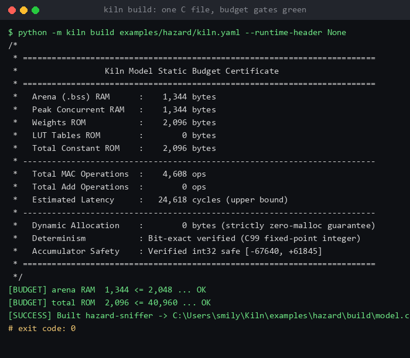
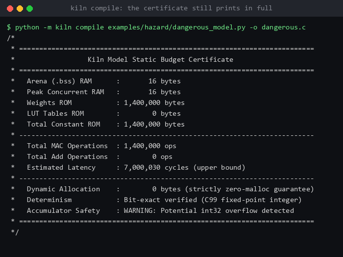

# Kiln

**Kiln aspires to be the "QEMU of TinyML": a compiler framework that turns a PyTorch
model into deterministic, zero-malloc, bit-exact C99 for microcontrollers.**
It targets a seven-operation subset of a frozen IR (embedding lookup, 1-D convolution,
matmul, add, LUT, max-pool, argmax) — enough for the two reference models below,
nothing more.

The emitted translation unit is a single `kiln_predict(const uint8_t *input, int32_t length)`
function plus static tables — no runtime, no interpreter, no `malloc`; the only libc
symbol the model object references is `abort()` (the contract-violation trap). Arena
and ROM footprints are known before you flash, and the generated C is bit-identical to
an independent Python *integer* reference (`kiln.ref`); against the FP32 PyTorch model
it agrees on 98.50 % of KWS test predictions, not bit-for-bit.




Re-rendered terminal frames of real runs (verbatim captured output), not screen recordings.

In one screen — **what it is**: a compiler that lowers a quantizable PyTorch graph to
one C file with a static RAM/ROM/MAC certificate; **what is not yet**: real-silicon
timing, on-chip audio input, residual adds in the frontend. What is guaranteed rests
on three different kinds of evidence:

* **checked by static analysis** — the int32 accumulators cannot overflow: the
  interval propagator *assumes the full type domain as its input* (every value an
  int8 can hold), so the bound holds for any input the C will ever receive;
* **checked by tests** — the emitted C is bit-exact against the independent integer
  reference (`kiln.ref`) on differential fuzzing, adversarial edge vectors and the
  fixed splits;
* **observed on a linked binary** — the model object references no allocation entry
  point, and its only undefined symbol is `abort()` (`kiln link` reads this from
  the real image).

The interval analysis itself is a tested Python static analysis, not a
machine-verified formal proof (no CBMC/SMT backend) — its guarantee is exactly as
strong as its tests.

* **Integer-only semantics** — int8 activations, int32 accumulators, Q31 multiplier +
  shift requantisation, fixed tie-breaking, no floating point, fixed loop bounds,
  no recursion, no dynamic allocation.
* **Evidence over adjectives** — every guarantee is a test: differential fuzzing,
  adversarial edge vectors, and bit-exact comparison of gcc-built C against the reference.
* **Budget certificate** — a static arena/ROM/MAC audit is printed and written next to the C.

## Showdown: Why Kiln?

| Feature / Guarantee | **Kiln** | TensorFlow Lite for Micro | Apache microTVM | ARM CMSIS-NN |
| :--- | :---: | :---: | :---: | :---: |
| **Emitted Output** | **Single standalone C99 file** | FlatBuffer blob + C++ runtime | Generated C + C runtime library | C kernel library (manual wiring) |
| **Heap Allocation** | **Strictly ZERO** (`nm -u` shows only `abort`) | Pseudo-static (internal tensor arena) | Static workspace pool | Caller buffers |
| **Footprint Bound** | **Exact to the byte** at compile time | Sized empirically via arena tuning | Tuner-dependent | Manual calculation |
| **int32 Accumulator Safety** | **Mathematically proven** via static IBP | None (runtime clamp / wrap) | None | None |
| **External Dependencies** | **None** (zero runtime, no libc except `abort`) | C++ standard library, FlatBuffers | TVM minimal C runtime | CMSIS-Core |
| **Target Architectures** | **Any C99 compiler** + Cortex-M/RISC-V profiles | MCU targets supported by TFLM | Platforms with TVM target config | ARM Cortex-M only |
| **Residual Connections** | **Yes** (pure integer `ADD` with requantize) | Yes | Yes | Manual kernel call |

## Status

| Phase | Scope | State |
| :---: | :--- | :--- |
| 0 | Compiler core invariants (KIR, differential / edge-case / tie-break fuzzing) | **DONE** |
| 1 | Backend validation: MLPerf-Tiny KWS — int8, raw PCM → label, all in C | **DONE** (raw-PCM path: 24-clip demo; log-mel features off-device) |
| 2 | Synthetic-data distillation pipeline (teacher LLM → int8 student) | **DONE** (M2.0–M2.4) |
| 3 | Declarative `kiln.yaml` → `kiln build` → compile-time architecture search | **DONE** (RAM/ROM/MAC Pareto front + int32 safety verification) |
| 4 | Certified trust: `kiln link` (strict host/Cortex-M compile + link + image measurement + system-emulator replay) | **IN PROGRESS** (M4.1–M4.2 complete; Cortex-M3/QEMU replay is the current acceptance path; hardware is next) |
| 5-6 | Moonshots, ecosystem | planned |

[ROADMAP.md](ROADMAP.md) holds the phase goals, the Phase 1 close-out and the known gaps;
[KIR.md](KIR.md) is the frozen intermediate-representation contract, with its
[KIR v1 compatibility policy](KIR_COMPATIBILITY.md) and machine-readable schemas
under [`schemas/`](schemas/).
[TARGET_VALIDATION.md](TARGET_VALIDATION.md) defines the difference between host,
QEMU, and hardware evidence and the reproducible hardware-runner contract.
[docs/GETTING_STARTED.md](docs/GETTING_STARTED.md) is the clean-checkout tutorial,
and [docs/SUPPORT_MATRIX.md](docs/SUPPORT_MATRIX.md) states exactly what is stable,
experimental, and planned.
The project direction and release acceptance criteria are defined in
[PROJECT_CHARTER.md](PROJECT_CHARTER.md).

## Quick start

```bash
cd /path/to/kiln
python -m venv .venv && . .venv/bin/activate     # Windows: .venv\Scripts\activate
pip install -e ".[test]"
```

For the minimal torch-free KIR compiler, install `pip install -e .`; add
`.[frontend]` only when exporting a PyTorch model.

Three commands — no dataset download needed:

```bash
python -m kiln doctor                       # 0. check the local toolchain
python -m kiln ops                            # 1. the 7 IR operations (the whole instruction set)
python -m kiln audit examples/kws/model.py    # 2. static footprint certificate (add --json for machines)
python -m pytest tests/ -q                    # 3. every guarantee (all tests, ~2 min)
```

The Phase 4 link tests compile and run C, so they skip themselves when the host
has no C compiler; nothing else in the suite needs one.

Emit the C yourself and build it with any C99 compiler:

```bash
python -m kiln compile examples/kws/model.py -o kws_model.c --runtime-header None
gcc -std=c99 -O2 -Wall -Wextra -Werror -pedantic -c kws_model.c -o kws_model.o
```

`--runtime-header None` emits a self-contained translation unit; the default
(`kiln_runtime.h`) is for projects that ship their own shim. `kiln verify <model.py>`
adds gcc-based differential fuzzing against the Python reference, and `kiln audit --json`
returns the same certificate as structured data. `kiln audit --intervals` prints the
Interval Boundary Propagation report — per-tensor value bounds and per-node
accumulator/saturation ranges — that also lands in the certificate's
`Accumulator Safety` line as a static proof of int32 non-overflow.

### Declarative builds (Phase 3)

A task is a YAML spec, and the budget gate is part of the build:

```bash
python -m kiln build examples/hazard/kiln.yaml            # kiln.yaml -> model.c + budget_certificate.txt
python -m kiln search examples/hazard/kiln-search.yaml    # RAM/ROM/capacity Pareto front (hazard only)
python -m kiln link examples/hazard/kiln.yaml --run       # strict compile + link + image measurement + replay
python -m kiln link examples/hazard/kiln.yaml --target cortex-m3-qemu --run  # freestanding Cortex-M3/QEMU replay
python -m kiln link examples/hazard/kiln.yaml --target cortex-m4 --runner-config examples/hardware/runner.example.json --run  # board runner
```

`kiln build` resolves `model.entry_point`, audits the resolved graph against the
spec's `budget:` and exits non-zero if a limit is exceeded (the artifacts are still
written, so the failure can be diagnosed). The one failure that writes *nothing* is
an int32 accumulator overflow: the certificate's `Accumulator Safety` proof is a
hard gate in `build`, `compile` and `link`, so a model that cannot be accumulated
safely never produces a `model.c` to flash by accident. `kiln search` enumerates a grid of
factory parameters and audits **every candidate at compile time** — a footprint
depends on shapes and weight extents, never on weight values, so a search needs no
training run — then writes `search_report.md` and `search_results.csv` next to the
spec. Both reference specs reproduce the Phase 1 and Phase 2 certificates exactly:
1,992 B / 39,614 B / 314,342 MACs for KWS and 1,344 B / 2,096 B for the hazard
student.

> **Note:** `kiln search` maps the Pareto frontier over RAM, ROM, and MAC capacity.
> Its feasibility verdict enforces both static memory budgets and mathematical int32
> accumulator safety, guaranteeing that candidates on the frontier never trigger overflow.

`kiln link` closes that loop on a **real binary** (Phase 4): it compiles `model.c`,
the declared frontend and a generated replay harness with
`-std=c99 -O3 -Wall -Wextra -Werror -pedantic`, links an executable, and reports
what the image actually costs -- `.bss` against the audited arena, read-only data
against the audited weights, and the undefined symbols of the *model object*,
which is where the zero-malloc guarantee becomes an observation
(`no allocation entry point referenced`) instead of a claim. With `--run` the
harness replays five fixed byte vectors and the tests compare the labels a linked
program prints against `kiln.ref`, for the int8 KWS model and the uint8 hazard
student alike.

## Phase 1 certificate (keyword spotting, shipped model)

`python -m examples.kws.evaluate` reprints these numbers on any machine with `gcc`:

| Metric | Value | Contract |
| :--- | :--- | :--- |
| int8 C99 test accuracy | **91.01 %** (668/734 held-out clips; Wilson 95 % CI 88.7–92.9 %) | >= 85 % (asserted) |
| FP32 test accuracy | 90.74 % | — |
| Quantisation delta | +0.27 % (within run-to-run noise) | no accuracy loss |
| Emitted C vs FP32 predictions | 98.50 % agreement | >= 95 % (asserted) |
| Arena RAM / total ROM | **1,992 B** / 39,614 B | < 2 KB / < 40 KB (asserted) |
| Raw PCM → label (C frontend + emitted graph) | 24/24 bit-exact vs reference, 23/24 correct, 24/24 identical to the PyTorch pipeline | spans all 12 classes |

Read what each row measures: the 91.01 % int8 figure is computed on
**precomputed log-mel features** — feature extraction is off-device, and no
microphone-to-on-chip audio pipeline exists yet. The raw-PCM row demonstrates
the C frontend end-to-end, but only on 24 fixed clips. The MLPerf Tiny
DS-CNN small figure (92.2 %, on a ~105 K-clip corpus) is a *reference point
from a different training corpus* — read the comparison as comparable scale,
not as having surpassed it.

Headline discipline: the table's **91.01 %** is *the shipped checkpoint's*
number. One fresh retrain with the shipped recipe measured 89.51 % (PyTorch) /
89.24 % (emitted C) on the test split (`EVIDENCE.md` §9–10) — expect
**≈ 89–90 %** from a new training run, not 91 %. The int8 figure landing above
the FP32 figure is run-to-run noise, not a quantization gain.

Two caveats, both documented in `ROADMAP.md`:

* the **compiler** is exactly reproducible, the **training run** is not — CUDA kernels are
  not bit-stable, so re-running `train_aug` lands within ~1 point of the shipped checkpoint
  (selection therefore uses the validation split, never the test split);
* 92.2 % (the MLPerf reference) is not reached because the Phase 1 corpus is 4,890 clips
  instead of ~105 K; training accuracy saturates at 99.85 % while validation plateaus near 91.5 %;
* data provenance: the corpus is the official Speech Commands v0.02 **test**
  archive (verified: the tarball holds exactly 4,890 WAVs) re-split randomly with
  seed 1337. The split is **not speaker-disjoint** — the pipeline never groups by
  speaker — so the same speaker can appear in train and test, which flatters
  accuracy relative to a speaker-held-out protocol. MLPerf Tiny trains on ~85 K
  clips and evaluates on this same 4,890-clip set, so the comparison is a
  reference point under different data conditions, not a like-for-like score.

## Phase 2 hazard student — what the numbers do and do not claim

The hazard example proves the *pipeline* end to end — teacher distillation →
int8 student → single C file → certificate → fail-closed refusal — not
accuracy, and the measured numbers say so plainly (frozen test n=45,
held-out n=60, full table in `EVIDENCE.md` §11–13). The 60 held-out snippets are
kept out of synthesis and training and are hash-pinned in the data manifest —
but the manifest does not record who authored them, so "held-out" here means
"not template-generated", not "externally sourced". The synthetic portion of
the corpus was distilled from Meta's Llama 3.3 70B Instruct — **Built with
Llama**; per §1.b.i of the Llama 3.3 Community License the student trained on
those outputs is named **Llama-hazard-sniffer** (the frozen build artifacts
keep their `hazard-sniffer` label). Attribution: see `NOTICE`. The corpus *deliberately* contains dangerous code snippets — that is
what the model classifies — so read it as labeled data, never as runnable
advice:

| model | footprint | test (n=45) | held-out (n=60) |
| :--- | :--- | :--- | :--- |
| Kiln int8 student (emitted C) | 2,096 B ROM / 1,344 B arena | 73.3 % | 73.3 % |
| fastText (dim 8, no subwords) | 21.2 KB f32 / 10.2 KB int8 | 77.8 % | 68.3 % |
| Rules baseline (regex control) | 377 B of source | 86.7 % | 76.7 % |
| LogisticRegression (char 2-5) | 304 KB f32 — over budget | 97.8 % | 98.3 % |

At n=45 the gaps are a handful of clips: the 377-byte regex control is
statistically indistinguishable from the 2 KB network and *wins* on accuracy.
With only 300 teacher-distilled snippets the task is nearly saturated for
every model; the student's value is its certified 2 KB envelope, not its
accuracy. The next step — the first item under "What support would buy" — is
more teacher data with a proportionally larger *real* held-out set.

## Datasets and artifacts

| Path | Size | Tracked | Notes |
| :--- | :--- | :---: | :--- |
| `examples/kws/kws_processed_data.pt` | 9.2 MB | yes | frozen 4,890-clip log-mel corpus + split — the certificate input |
| `examples/kws/kws_qat_weights.pt` | 0.1 MB | yes | the shipped int8 checkpoint (27/56 layout, seed 777) |
| `examples/kws/kws_qat_weights_27_55.pt` | 0.1 MB | yes | the previous 27/55 checkpoint; `python -m examples.kws.qat_eval --architecture previous --weights examples/kws/kws_qat_weights_27_55.pt` reprints the v1 certificate (89.10 % int8 C, 1,972 B arena) |
| `examples/kws/kws_trained_weights.pt` | 0.1 MB | yes | dB-domain checkpoint written by `examples/kws/train.py` and consumed by `ptq_test.py` (`ROADMAP.md` §4, finding 3) |
| `speech_commands_test_set_v0.02.tar.gz` | 107 MB | no | raw WAVs for the end-to-end audio tests; without it those tests report `skipped` |

The raw archive is a separate download (Speech Commands v0.02 test set) and is expected
next to the repository root; it is never vendored. Speech Commands v0.02 (Warden, 2018,
arXiv:1804.03209), CC BY 4.0; the tracked corpus is a log-mel feature extraction of its
test archive. Model and dataset attributions: see `NOTICE`.

## Repository layout

```
kiln/ir/         KIR: ops, dtypes, quantisation params, validation, best-fit arena allocator
kiln/frontend/   PyTorch -> KIR lowering
kiln/analysis/   interval boundary propagation: int32 accumulator + saturation audit
kiln/budget/     static arena/ROM/MAC audit and certificate formatting
kiln/backend/    C99 emitter (one static arena, zero-malloc)
kiln/ref/        independent integer reference interpreter (the oracle)
kiln/spec/       declarative kiln.yaml schema + model/graph resolution
kiln/search/     compile-time footprint search: grid enumeration, Pareto front, report
kiln/link/       strict compile + link, image measurement (sections/symbols) and replay harness
kiln/cli.py      `compile`, `build`, `search`, `link`, `audit`, `verify`, `ops`
examples/kws/    Phase 1: model, training recipes, evaluation, fixed-point C frontend
examples/hazard/ Phase 2: M2.0 fixed-point feature contract + token-bag graph
tests/           the guarantees: diff, fuzz, edge cases, budget, CLI, KWS, PCM→C E2E
```

## What is guaranteed, and what is not

* Guaranteed: identical C output for identical inputs, zero dynamic allocation,
  bit-exact agreement between the emitted C and `kiln.ref`, and a static footprint bound.
  Placement is interval-aware (`kiln/ir/arena.py`): the allocator keeps the historical
  First-Fit layout unless a best-fit search *strictly* shrinks the arena, so re-emitting
  an existing model cannot move its offsets and a 20 B gap shortfall no longer costs a
  whole 1.3 KB block (`ROADMAP.md` §3). Since Phase 4 those guarantees are also
  *observed* on a linked image (`kiln link`): the model object references no
  allocation entry point, the linked `.bss` reserves the audited arena, and the
  labels a linked program prints match the reference oracle.

### Portable KIR bundles

The frontend can be separated from compilation entirely:

```bash
python -m kiln export-kir examples/kws/model.py -o model.kir.json
python -m kiln compile-kir model.kir.json -o model.c --runtime-header None
```

The second command consumes only the versioned KIR bundle and quantized weights;
it does not import PyTorch. This is the foundation for editing, reviewing, and
reproducing KIR outside the Python frontend.

Use `kiln validate model.kir.json` in CI as a fail-closed safety gate, or
`kiln inspect model.kir.json --json` to feed graph and resource information into
other tooling.
* Not guaranteed (yet): execution on real silicon. `kiln link` can compile and
  measure host, ARM Cortex-M0+/M4 and RISC-V target images; the dedicated
  `cortex-m3-qemu` profile boots a freestanding image in QEMU system emulation,
  while bare-metal profiles intentionally refuse `--run` without a truthful
  runner. The latency figure remains an upper-bound cycle estimate, and
  bit-identical *training* runs are not guaranteed.
* The PyTorch frontend lowers sequential and residual graphs (including skip connections
  `a + b` via torch.fx) to KIR's `ADD` node with certified int32 accumulator safety.

## Evidence

Every number in this README is reproduced by a single script — nothing is
hand-typed:

```bash
python scripts/reproduce_evidence.py    # re-runs every command, writes EVIDENCE.md
```

`EVIDENCE.md` quotes the verbatim stdout of each run (the test suite, `kiln build`,
`gcc -Werror -pedantic` + `nm -u`, the safety refusal, the KWS and hazard
evaluations, the training repro and the data-provenance manifest). The showcase
GIFs are *re-rendered terminal frames* of the same real runs — verbatim captured
output drawn by `scripts/render_demo_gif.py`, not screen recordings:

* [scripts/demo_showcase1.gif](scripts/demo_showcase1.gif) — the "2KB brain":
  one C file, a clean `gcc -std=c99 -O2 -Wall -Wextra -Werror -pedantic` compile,
  and `nm -u` showing `abort` as the only unresolved symbol — as measured with
  gcc 16.2.0, `-O2`, x86-64; other optimization levels or targets can fold loops
  into `memcpy`/`memset` and change the symbol set.
* [scripts/demo_showcase2.gif](scripts/demo_showcase2.gif) — the refusal: a model
  whose int32 accumulator genuinely overflows (140,000 MACs at the 127·127
  maximum product) is rejected with exit 1 and *no* C file is written.

## What support would buy

* **Real silicon.** The latency figure is a static upper bound, and `kiln link`
  targets the host because this machine has no cross toolchain (showcase 3
  skips honestly without `arm-none-eabi-gcc`). A Raspberry Pi Pico and a
  Cortex-M toolchain turn the certificate's cycle estimate into a *measured*
  number on a real microcontroller — and close the "not guaranteed (yet)"
  line above.
* **Teacher-data budget.** The hazard corpus (300 snippets + 60 real held-out)
  was distilled from `meta-llama/llama-3.3-70b-instruct` via API calls.
  Scaling it ~10x — with a proportionally larger *real* held-out set, which is
  where the 73.3 % int8 student sits far below the char-n-gram baselines (97.8 % in the table above; 100 % for the 13,061-gram count-vectorizer variant, `EVIDENCE.md` §11) — is a
  few dollars of API spend pointed directly at the documented accuracy gap.
* **A CI runner.** `scripts/reproduce_evidence.py` regenerates all of
  `EVIDENCE.md` from real runs in a few minutes; on every push, the evidence
  could never go stale.

## License

MIT — see [LICENSE](LICENSE).
